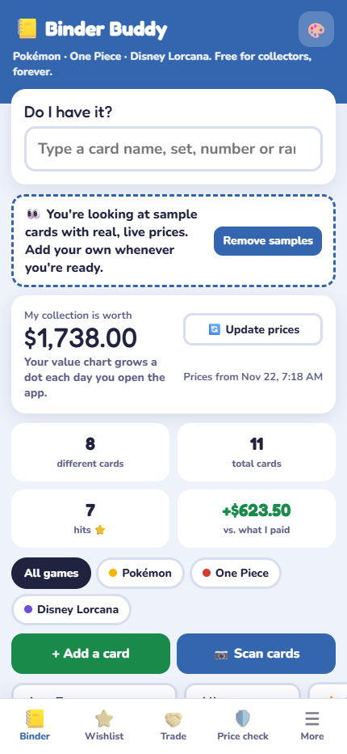
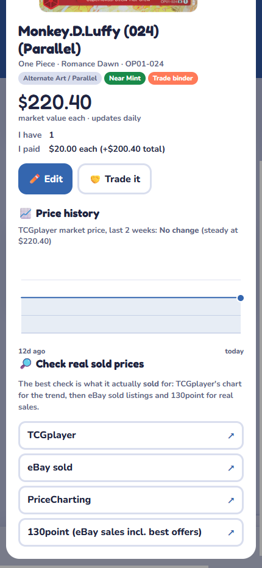
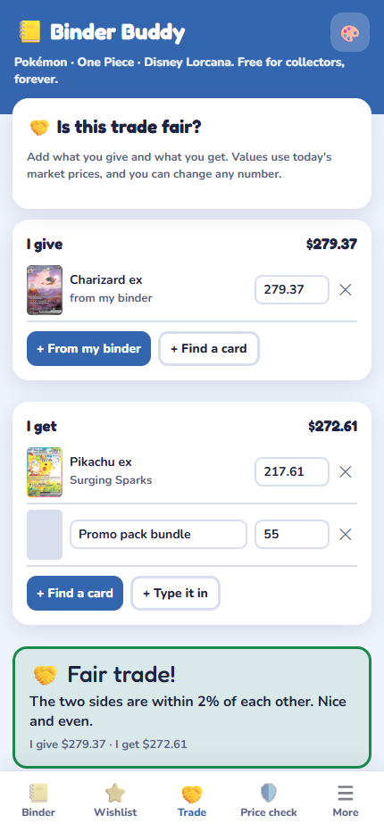
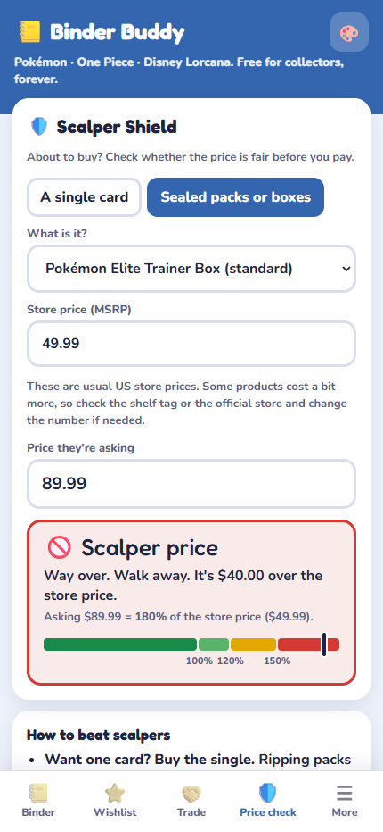

# 📒 Binder Buddy

**A free, private card binder for Pokémon, One Piece and Disney Lorcana collectors.**
Scan your cards, see live prices and price history, check if a trade is fair, and spot scalper prices before you pay.

**▶ Use it:** https://micahalaniz.github.io/binder-buddy/ (works on any phone; "Add to Home Screen" to install)
**📖 Case study:** [How it's built](https://micahalaniz.github.io/binder-buddy/case-study.html)

by **Micah Alaniz · Sweet Onion Studios** 🧅

<p>




</p>

## Why

Collection apps charge a monthly subscription for the features collectors need most (scanning, price history, exports), and kids get burned by scalper prices and lopsided trades. Binder Buddy gives everyone those tools free, with no account, no ads and no tracking.

## Features

| | |
|---|---|
| 📷 **Scanner** | Photograph one card or a whole 9- or 12-pocket binder page. On-device OCR reads the printed card code (`238/191`, `OP01-120`, `207/204 • EN • 1`) and matches it. You confirm every match. |
| 💵 **Live prices** | Linked cards update once a day from free community databases (TCGplayer market prices). |
| 📈 **Price history** | A daily chart of your collection's value and of each card. One Piece shows 2 weeks of TCGplayer history, and Pokémon shows the Cardmarket 7- vs 30-day trend. Each card also has one-tap links to its exact TCGplayer page, eBay **sold** listings, PriceCharting and 130point. |
| 🔎 **Do I have it?** | Type any name, set, number or rarity and get an instant yes or no. |
| ⭐ **Wishlist** | Set the most you'd pay, and it tells you when the market reaches your price. |
| 🤝 **Trade checker** | "I give" vs. "I get" at market value, with a clear fair / ahead / behind call. It updates your binder when the trade is done. |
| 🛡️ **Scalper Shield** | Compares an asking price to market value (singles) or store price (sealed) on a gauge, with tips for beating scalpers. |
| 💰 **Bundle value** | Prices a pile at a percentage of market for selling to a shop or posting a lot. |
| 📤 **Share my hits** | Makes a picture of your best cards to post, with prices optional and off by default. |
| 🎨 **Make it yours** | 9 themes plus custom colors, dark mode, color-coding and grouping (game, rarity, condition, tag), tags, list/compact/grid layouts and photo options. |
| 💾 **Your data** | Backup files (with photos), CSV export, bulk add and offline use (PWA). |

## How it works

- **No backend at all.** It's a static site on GitHub Pages, so hosting costs $0 and there's no server to leak data from.
- **Local-first:** cards, photos (as compressed JPEG blobs), the wishlist and price logs live in **IndexedDB**. Settings and value history live in `localStorage`.
- **Open data:** [TCGdex](https://tcgdex.dev) (Pokémon), [Lorcast](https://lorcast.com) (Lorcana) and [OPTCG API](https://optcgapi.com) (One Piece). All are free, keyless and CORS-enabled. Results are normalized into one card shape (`js/catalog.js`), cached in IndexedDB, and rate-limited politely (Lorcast asks for 50–100 ms between calls).
- **On-device OCR:** [Tesseract.js](https://github.com/naptha/tesseract.js) runs in a Web Worker and is lazy-loaded on the first scan. Each pocket is cropped, greyscaled and contrast-boosted. It reads the whole card, then zooms on the code strip and stops early once an exact code is found. Pokémon codes like `025/165` are matched by finding sets with 165 cards, then fetching card 025 in each.
- **Charts** are hand-built SVG (no chart library) with a touch crosshair/tooltip and a screen-reader table.
- **Vanilla JS, ES modules, no build step, no dependencies.**

```
index.html            app shell (5 tabs + sheets)
css/app.css           themeable design system (CSS variables, light/dark)
js/app.js             boot, tabs, daily auto price refresh
js/logic.js           pure logic: rarities, verdicts, bundle math, OCR text parsing (unit tested)
js/catalog.js         card databases → one shape; prices; history
js/scan.js            OCR pipeline        js/scanui.js   scan → confirm → add
js/binder.js          binder list, details, edit, photos
js/wishlist.js  js/trade.js  js/pricecheck.js  js/share.js  js/more.js
js/store.js           IndexedDB + settings      js/chart.js   SVG line chart
sw.js                 offline: network-first app, cache-first card images
tests/                unit tests (open tests/index.html) + scanner test on real card images
```

## Run it locally

Serve the folder with any static server (for example `npx serve` or `python -m http.server`) and open it. Unit tests are at `/tests/`, and the scanner accuracy test is at `/tests/scan.html`.

## Accessibility & quality

Keyboard and screen-reader friendly (labelled controls, dialogs with Escape and focus return, live regions, a data table behind every chart). It honors `prefers-reduced-motion` and forced colors, uses self-hosted fonts (no Google requests), and has a 13-group unit test suite for the core logic.

## Promise

Free forever, every feature. No ads, no accounts, no tracking, no selling data. No bot or restock-sniping tools. If it ever earns money, it'll be through optional tips or clearly disclosed shop links, never a paywall.

## Credits & legal

Card data and prices: TCGdex, Lorcast, OPTCG API. OCR: Tesseract.js (Apache-2.0). Fonts: Fredoka and Nunito (SIL OFL).
Not affiliated with or endorsed by The Pokémon Company, Nintendo, Bandai, Disney, Ravensburger or TCGplayer. Card names and images belong to their owners. Prices are estimates, not offers.

Code © 2026 Micah Alaniz / Sweet Onion Studios, MIT licensed.
